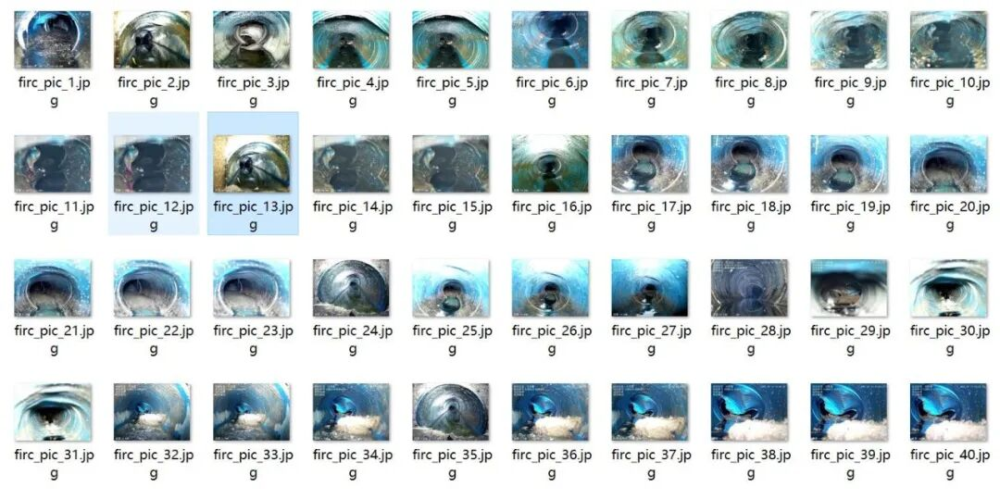
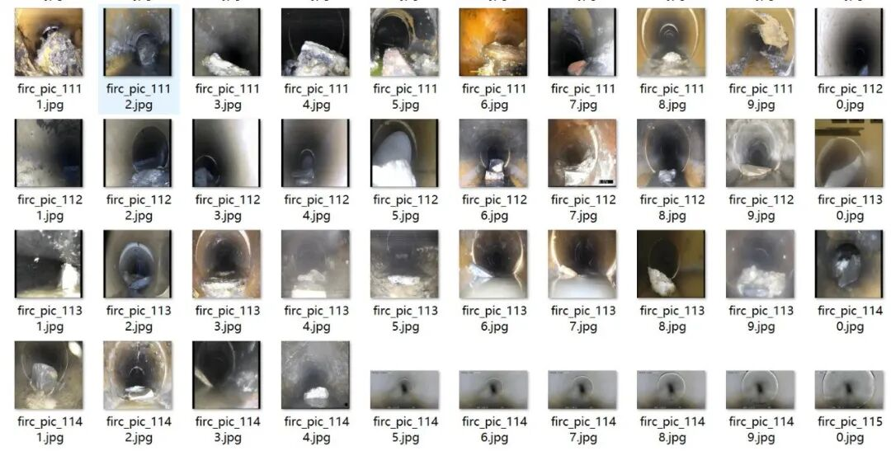
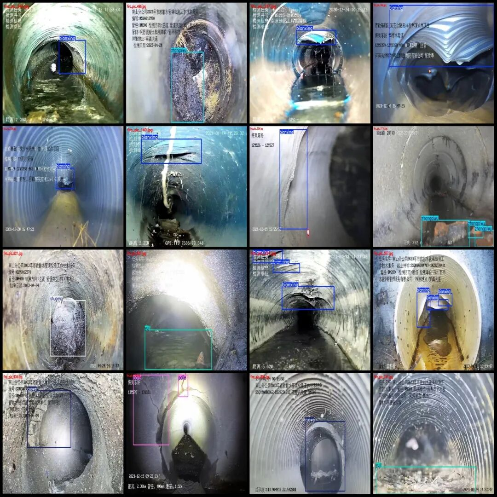
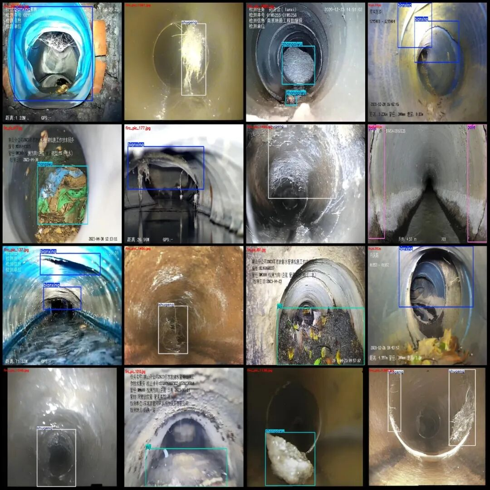
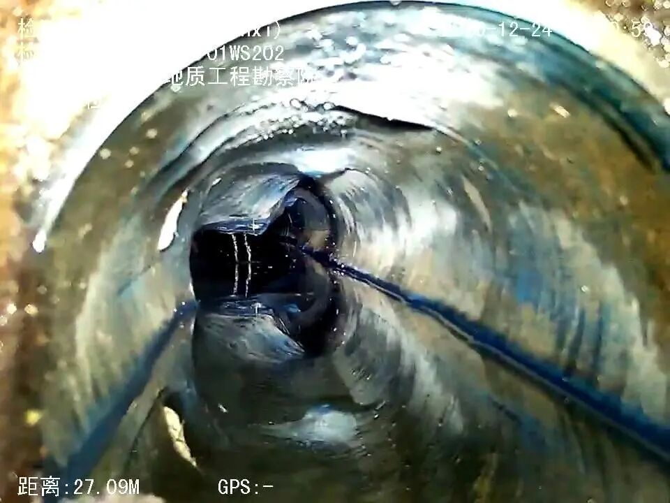
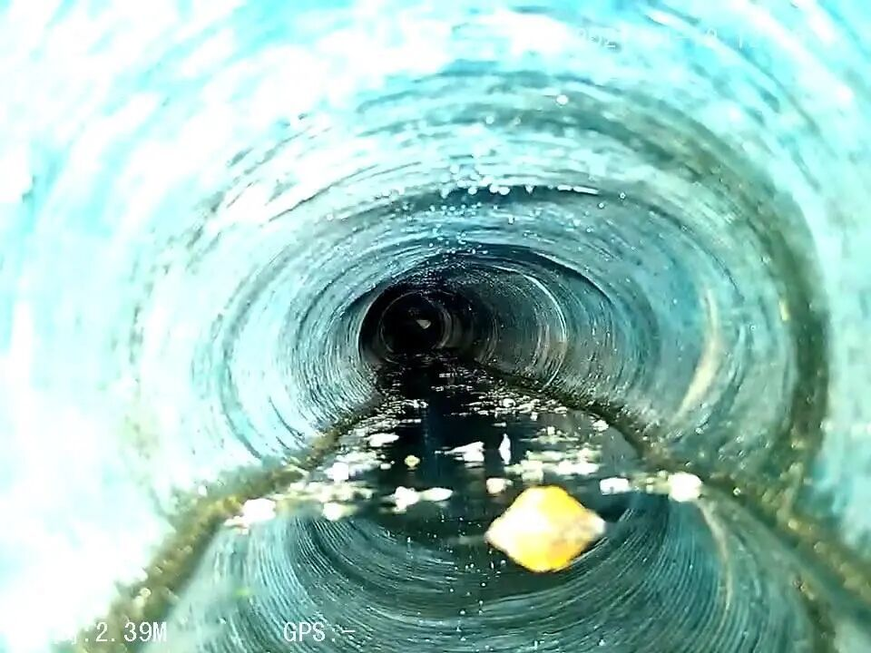
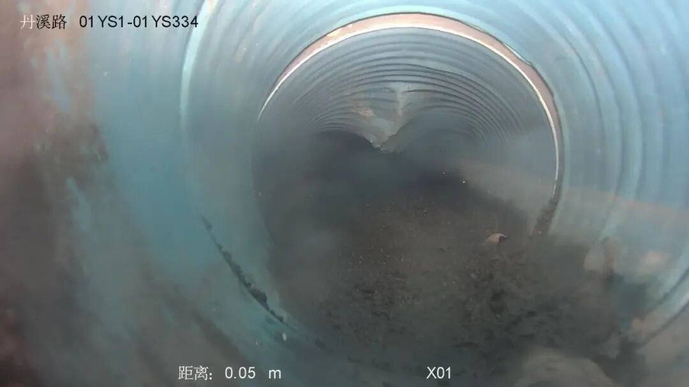

# Underground pipeline defect detection dataset in VOC+YOLO format with 1910 images and 6 categories

Dataset format: Pascal VOC format + YOLO format (txt file without split path, only containing jpg images and corresponding VOC format xml files and yolo format txt files)

Number of images (number of jpg files): 1910

Number of XML files: 1910

Number of annotations (number of txt files): 1910

Label categories: 6

Label category names (Note that the order of labels in the YOLO format does not correspond to this, but is based on the classes.txt file in the labels folder): ["bianxing", "cuowei", "polie", "shugeng", "yuji", "zhangaiwu"]

The number of boxes and the number of images each category is labeled with:

Bianxing (transformation) box count = 620, occupying image count = 455

cuowei (misalignment) frame count = 38, occupied picture count = 35

Pole (fracture) frame count = 318, occupied picture count = 210

shugeng (root) frame count = 671, occupying image count = 438

Yuji (sedimentation) frame count = 426, occupied picture count = 365

Zhangaiwu (obstacle) Frames = 710, Pictures Taken = 480

Total frame count: 2783

Image resolution: Multi-resolution images, such as 960x720, 1920x1080, etc.

Use labelImg:

Annotation rules: Draw a rectangle around the category.

Important Note: The dataset does not have separate training, validation, and test sets; you will need to partition them yourself.

Special : This dataset does not guarantee the accuracy of the trained models or weight files.

Preview of the image:

Annotation example:

Single image:

## Payment

Here is a pay link on Stripe ( https://buy.stripe.com/3cs8yP7sY87d0vu9AB ). Please contact me lonlonago@foxmail.com after funding $89, and I will send you a complete data files , thank you!

